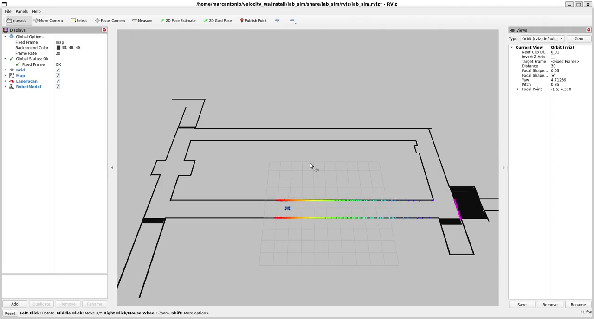

# TMU Velocity labs

My software onboarding labs for TMU Velocity, Toronto Metropolitan University's autonomous vehicles design team. I'm on the software team for the RoboRacer (F1TENTH) autonomous racing program, which runs on ROS 2 and Ubuntu.

Built by [Marcantonio Povolo](https://marcantoniopovolo.com), a Computer Engineering student at TMU.

## What I did

- Completed software onboarding Labs 1 and 2 in ROS 2 on Ubuntu, resolving ROS distribution and package conflicts along the way.
- Set up the RoboRacer simulator in Docker and wrote an emergency-braking safety node with AI assistance (ChatGPT), then tested it in simulation.
- Labs 3 and 4 (wall following and follow the gap) were written with AI assistance (Claude Code) and tested in the RoboRacer simulator running natively on Ubuntu, without Docker.

These are Labs 1 to 4 of the [RoboRacer course](https://f1tenth-coursekit.readthedocs.io/en/latest/) (formerly F1TENTH), which the team uses for software onboarding:

| Lab | What it is | Folder |
|---|---|---|
| Lab 1: Introduction to ROS 2 | ROS 2 basics: workspaces, packages and nodes that publish and subscribe to messages | [lab1/](lab1/) |
| Lab 2: Automatic Emergency Braking | A safety node that stops the car before a collision, using Time to Collision calculated from the LaserScan data in the RoboRacer simulator | [lab2/](lab2/) |
| Lab 3: Wall Following | A PID controller that holds a set distance from the inner wall to drive laps | [lab3/](lab3/) |
| Lab 4: Follow the Gap | A reactive planner that drives toward the free space it fits through, on an empty track and one full of obstacles | [lab4/](lab4/) |

[](lab4/media/lab4_follow_the_gap_fast.mp4)

*Lab 4 at `max_speed` 10, recorded in RViz. Each lab's folder has its own videos.*

## Layout

| Path | What it is |
|---|---|
| `lab1/` to `lab4/` | One folder per lab: the ROS 2 package source, its videos in `media/`, and a short note on what I did |
| `sim/lab_sim/` | Launches the RoboRacer simulator on a chosen map and start pose, and puts the car back on the start line after a crash; the Lab 2, 3 and 4 tasks use it |
| `.vscode/` | VS Code tasks to build, test and run each lab, and workspace settings for ROS 2 |

ROS 2's generated folders (`build/`, `install/`, `log/`) aren't committed; `colcon build` recreates them.

## Build and run

On Ubuntu 22.04 with ROS 2 Humble and [f1tenth_gym_ros](https://github.com/f1tenth/f1tenth_gym_ros) in `~/f1tenth_gym_ros` (with the `levine_blocked` and `levine_obs` maps in its `maps/` folder), link the packages into a colcon workspace and build:

```bash
mkdir -p ~/velocity_ws/src
cd ~/TMU-Velocity-Labs
ln -s $PWD/lab1/lab1_pkg $PWD/lab2/safety_node $PWD/lab3/wall_follow $PWD/lab4/gap_follow $PWD/sim/lab_sim ~/f1tenth_gym_ros ~/velocity_ws/src/
cd ~/velocity_ws && colcon build --symlink-install && source install/setup.bash
```

The easiest way to run everything is VS Code, connected to WSL with this folder open: **Terminal → Run Task…** lists a task for each lab (each builds first), plus **Build labs** (Ctrl+Shift+B) and **Run tests**. Stop a lab with the trash-can icon on its terminal before starting another: only one simulator can run at a time, and the launcher refuses to start a second.

From a terminal:

```bash
ros2 launch lab1_pkg lab1_launch.py                         # Lab 1: talker + relay
ros2 launch lab_sim sim_launch.py                           # Lab 2: simulator, then in other terminals:
ros2 run safety_node safety_node --ros-args -p use_sim_time:=true
ros2 run teleop_twist_keyboard teleop_twist_keyboard        #   drive with the keyboard
ros2 launch wall_follow wall_follow_launch.py sim:=true     # Lab 3: simulator + RViz + wall follower
ros2 launch gap_follow levine_blocked_launch.py sim:=true   # Lab 4: simulator + RViz + follow the gap
ros2 launch gap_follow levine_obs_launch.py sim:=true       # Lab 4 on the obstacle map
```

Add `max_speed:=10.0` to a Lab 3 or Lab 4 launch to run it fast. Leave out `sim:=true` to start only the lab's node (on the car, or with a simulator that's already running).

The simulator runs on sim time from `lab_sim`'s steady clock, because WSL's system clock can jump by minutes and freeze ROS timers. If the car crashes, it is put back on the start line (`reset_on_crash:=false` turns that off).
