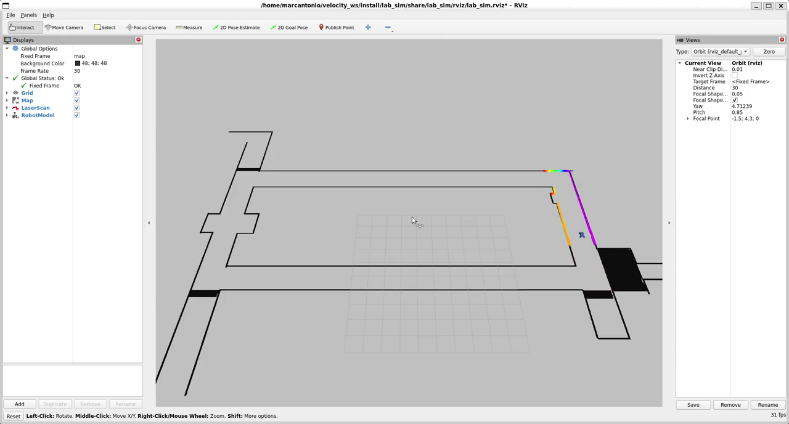
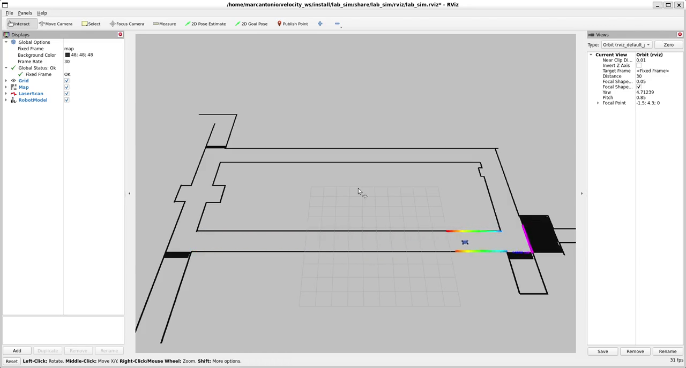

# Lab 3: Wall Following

[RoboRacer Lab 3](https://github.com/f1tenth/f1tenth_lab3_template): drive laps by holding a set distance from a wall, using a PID controller on the LiDAR data.

| Normal speed (1.5 m/s): one lap in about 46 s | Fast (`max_speed` 10): about 15 s a lap |
|---|---|
| [](media/lab3_wall_following_normal.mp4) | [](media/lab3_wall_following_fast.mp4) |

*Click a picture to play its video: screen recordings of RViz while the car drives counter-clockwise laps of `levine_blocked` in the RoboRacer simulator, without touching a wall.*

## How it works

The package is in [wall_follow/](wall_follow/). The node `wall_follow_node` reads `/scan` and publishes `/drive`. It follows the **left** wall, the inner wall on a counter-clockwise lap.

1. Take two beams on the left: `b` at 90° and `a` at 90° − θ (θ = 50°).
2. Angle to the wall: `α = atan((a·cos θ − b) / (a·sin θ))`.
3. Distance now: `D_t = b·cos α`. Distance one lookahead ahead: `D_t+1 = D_t + L·sin α` (L = 1.0 m).
4. Error = desired distance (1.0 m) − `D_t+1`, fed through PID (Kp = 1.0, Ki = 0, Kd = 0.1) to get the steering angle.
5. Speed from the steering angle: 1.5 m/s under 10°, 1.0 m/s under 20°, 0.5 m/s otherwise.

Scans arrive every 4 ms, so the raw derivative of the error is mostly LiDAR noise: it flipped the steering left and right about 80 times a second. The derivative and the steering are low-pass filtered (50 ms), which took the average steering change per command from 4.7° to 0.12° without changing the laps. When the node is stopped it sends a stop command, so the car doesn't keep driving on its last command.

A doorway can look like a corner to two beams. The node tells them apart the way the lab suggests: if the left wall disappears but there is open space more than 6 m ahead, it is a doorway, so the car drives straight past it instead of turning in.

All values are ROS parameters with these defaults (`kp`, `ki`, `kd`, `desired_distance`, `lookahead`, `theta_deg`, `side`).

### Changing the speed

There is one setting, `max_speed` (default 1.5 m/s), at the top of `wall_follow_node.py`. The lab's speed table is scaled to it: full speed under 10° of steering, two thirds from 10° to 20°, one third above, which at 1.5 gives exactly the lab's 1.5 / 1.0 / 0.5 m/s. Any value is safe to try, because the node also:

- limits speed in a turn to what the tyres can hold: `sqrt(grip · wheelbase / tan(steering))`,
- brakes for a wall ahead early enough to be down to 2 m/s 1 m before it,
- above 1.5 m/s, looks further ahead and softens the PID gains,
- speeds up gradually (slowing down is never delayed),
- turns into a corner when the wall beside it ends with a wall ahead (and drives straight past a doorway when there is open space ahead).

To try a speed without editing the file: `ros2 launch wall_follow wall_follow_launch.py sim:=true max_speed:=10.0`, or the **Lab 3 - Wall following (fast, 10 m/s)** task in VS Code.

Tested in the simulator without touching a wall: `max_speed` 1.5 (≈46 s laps), 2, 3 (≈28 s), 4 (≈18 s), 5 (≈15 s) and 10 (≈14.5 s; the car tops out near 6 m/s on Levine).

## Run it

In VS Code (connected to WSL), **Terminal → Run Task… → Lab 3 - Wall following (normal, 1.5 m/s)**, or:

```bash
ros2 launch wall_follow wall_follow_launch.py sim:=true  # simulator on levine_blocked + RViz + the node
ros2 run wall_follow wall_follow_node                    # just the node, e.g. on the car
```

The tests in [wall_follow/test/](wall_follow/test/) check the node like the lab's grader does, on synthetic corridor scans: too close to either wall, or turned toward either wall, it must steer away. Run them with `python3 -m pytest lab3/wall_follow/test`.

Written with AI assistance (Claude Code) and tested in the RoboRacer simulator.
