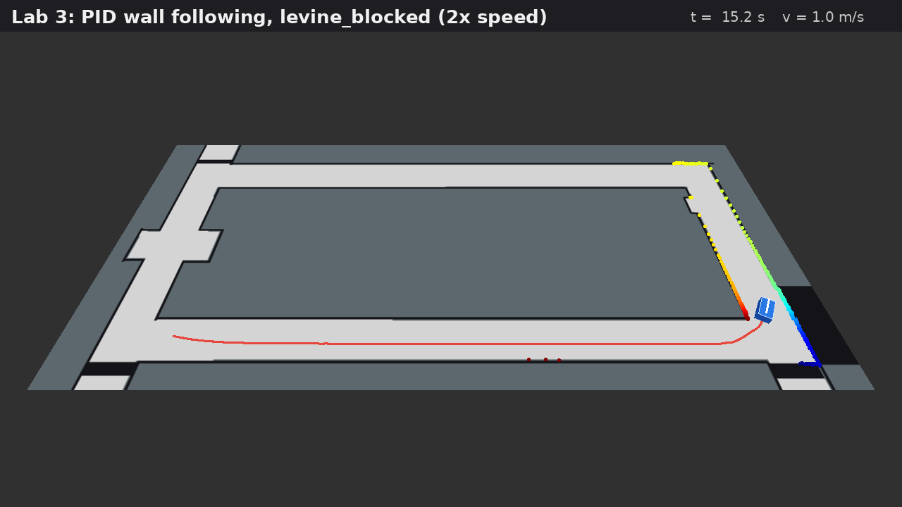

# Lab 3: Wall Following

[RoboRacer Lab 3](https://github.com/f1tenth/f1tenth_lab3_template): drive laps by holding a set distance from a wall, using a PID controller on the LiDAR data.

[](media/wall_follow_levine_blocked.mp4)

*Click the picture to play the video: a replay of a simulator run, drawn from the car's recorded positions with its laser scan (2x speed). One counter-clockwise lap of `levine_blocked` in 43.5 s without touching a wall.*

## How it works

The package is in [wall_follow/](wall_follow/). The node `wall_follow_node` reads `/scan` and publishes `/drive`. It follows the **left** wall, the inner wall on a counter-clockwise lap.

1. Take two beams on the left: `b` at 90° and `a` at 90° − θ (θ = 50°).
2. Angle to the wall: `α = atan((a·cos θ − b) / (a·sin θ))`.
3. Distance now: `D_t = b·cos α`. Distance one lookahead ahead: `D_t+1 = D_t + L·sin α` (L = 1.0 m).
4. Error = desired distance (1.0 m) − `D_t+1`, fed through PID (Kp = 1.0, Ki = 0, Kd = 0.1) to get the steering angle.
5. Speed from the steering angle: 1.5 m/s under 10°, 1.0 m/s under 20°, 0.5 m/s otherwise.

A doorway can look like a corner to two beams. The node tells them apart the way the lab suggests: if the left wall disappears but there is open space more than 6 m ahead, it is a doorway, so the car drives straight past it instead of turning in.

All values are ROS parameters with these defaults (`kp`, `ki`, `kd`, `desired_distance`, `lookahead`, `theta_deg`, `side`).

### Changing the speed

The three speeds are the `straight_speed`, `medium_speed` and `slow_speed` parameters at the top of `wall_follow_node.py`. Any value is safe to try: on top of the speed table, the node:

- limits speed in a turn to what the tyres can hold: `sqrt(max_lateral_accel · wheelbase / tan(steering))`,
- brakes for a wall ahead early enough to be down to 1.5 m/s 1.5 m before it,
- looks further ahead (0.6 s of travel) and softens the PID gains above the 1.5 m/s they were tuned at.

Tested in the simulator: clean laps with `straight_speed` at 1.5, 4.8 and 10 (the car tops out around 4 m/s on Levine).

## Run it

In VS Code (connected to WSL), **Terminal → Run Task… → Lab 3: wall follow (simulator)**, or:

```bash
ros2 launch wall_follow wall_follow_launch.py sim:=true  # simulator on levine_blocked + RViz + the node
ros2 run wall_follow wall_follow_node                    # just the node, e.g. on the car
```

The tests in [wall_follow/test/](wall_follow/test/) check the node like the lab's grader does, on synthetic corridor scans: too close to either wall, or turned toward either wall, it must steer away. Run them with `python3 -m pytest lab3/wall_follow/test`.

Written with AI assistance (Claude Code) and tested in the RoboRacer simulator.
