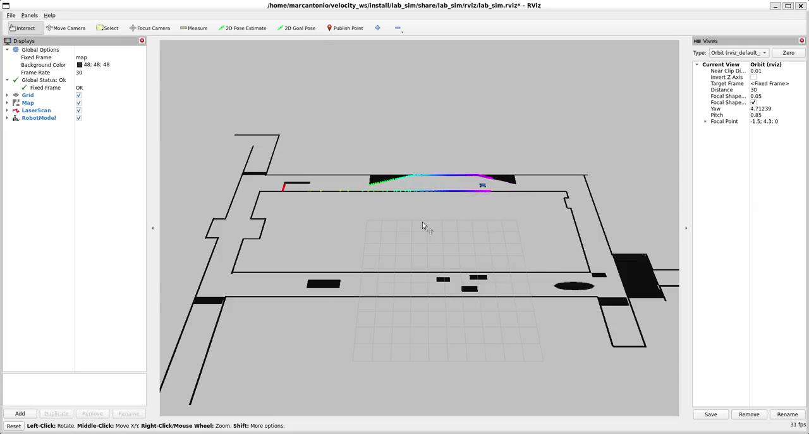

# Lab 4: Follow the Gap

[RoboRacer Lab 4](https://github.com/f1tenth/f1tenth_lab4_template): a reactive planner that drives toward free space in the LiDAR scan, on an empty track and on one full of obstacles.

## Results in the simulator

**levine_blocked**: 3 counter-clockwise laps in a row without touching a wall at the normal 2 m/s (about 32 s a lap), and at `max_speed` 10 (about 15 s a lap).

| Normal speed (2 m/s) | Fast (`max_speed` 10) |
|---|---|
| [](media/lab4_follow_the_gap_normal.mp4) | [](media/lab4_follow_the_gap_fast.mp4) |

**levine_obs**: starting on the east hallway heading north, the car clears 3 of the 4 corners (through the triangles, past the L-shaped dead-end pocket and the first box) and then clips a box in the slalom on the south hallway, where the gap between two boxes is about 0.45 m for a 0.31 m wide car. A full clean lap of this map is still to do.

[](media/lab4_follow_the_gap_obstacles.mp4)

*Click a picture to play its video: screen recordings of RViz while the car drives in the RoboRacer simulator.*

## How it works

The package is in [gap_follow/](gap_follow/). The node `reactive_node` reads `/scan` and publishes `/drive`.

1. **Preprocess**: keep the beams within ±90° of straight ahead, clip readings at 8 m, smooth with a 5-beam average. Then extend disparities: where a near obstacle edge sits next to far space, widen the obstacle by 0.25 m (half the car plus a margin), so a gap only looks open if the car fits through it.
2. **Closest point**: find the nearest reading.
3. **Bubble**: zero every beam within 0.3 m of it.
4. **Max gap**: split the free beams (further than 2.0 m) into runs and pick the run that leads furthest forward (largest `range · cos(angle)`). Walls closer than 2 m don't count as free, so a wall right beside the car at a corner can't look like the way to go.
5. **Best point**: inside that gap, take the beams within 90% of the best forward progress, and aim at the middle of the run closest to straight ahead.
6. **Drive**: steer at that point's angle, at 2.0 / 1.5 / 1.0 m/s depending on how sharp the turn is, and slow down when anything is within 1.5 m ahead.

Changes from the textbook version, each one fixing a crash or wrong turn found in testing:

| Change | Why |
|---|---|
| Score gaps and points by forward progress, not width or raw depth | At corners the hallway the car just left can look as deep as the way ahead, and the car U-turned into it. On levine_obs the wide L-shaped pocket out-voted the narrow passage that continues. |
| Ignore anything closer than 2 m as free space | Nearby walls at a corner formed a "gap" pointing into the corner. |
| Don't steer toward a side with something right beside the car (0.3 m beside the front, 0.17 m beside the rear) | The car cut the inside of corners and clipped them. |

### Changing the speed

There is one setting, `max_speed` (default 2.0 m/s, set to 1.5 for levine_obs in its launch file). The car drives at full speed under 10° of steering, 75% from 10° to 20° and 50% above or when something is within 1.5 m ahead. On top of that the node limits speed in a turn to what the tyres can hold, brakes for anything ahead early enough to be down to 2 m/s 1 m before it, and above 2.5 m/s smooths the steering and keeps a wider margin from obstacle edges and walls beside it, so it doesn't cut corners.

To try a speed without editing a file: `ros2 launch gap_follow levine_blocked_launch.py sim:=true max_speed:=10.0`, or the **Lab 4 - Follow the gap (fast, 10 m/s)** task in VS Code. When the node is stopped it sends a stop command, so the car doesn't keep driving on its last command.

Tested on levine_blocked, three laps each without touching a wall: `max_speed` 2 (≈32 s laps), 3 (≈22 s), 5 (≈15 s) and 10 (≈15 s). On levine_obs, keep to 1.5: faster, the car takes the wrong line at the L-shaped pocket.

Each map has its own launch file, with its own parameters:

| Map | Launch file | `max_speed` |
|---|---|---|
| levine_blocked | `levine_blocked_launch.py` | 2.0 m/s (default) |
| levine_obs | `levine_obs_launch.py` | 1.5 m/s |

## Run it

In VS Code (connected to WSL), **Terminal → Run Task…** and pick a Lab 4 task, or:

```bash
ros2 launch gap_follow levine_blocked_launch.py sim:=true  # simulator + RViz + the node
ros2 launch gap_follow levine_obs_launch.py sim:=true
ros2 launch gap_follow levine_obs_launch.py                # just the node, as the lab's grader runs it
```

Without `sim:=true` the launch files start only the node with that map's parameters, which is what the lab's grader expects (it runs its own simulator).

The tests in [gap_follow/test/](gap_follow/test/) check the node like the grader does, on synthetic scans, each also mirrored: a pillar ahead (steer toward the wider side), a corridor with the car near one wall (steer toward the open side) and a dead end with the exit to one side (aim into the exit). Run them with `python3 -m pytest lab4/gap_follow/test`.

Written with AI assistance (Claude Code) and tested in the RoboRacer simulator.
