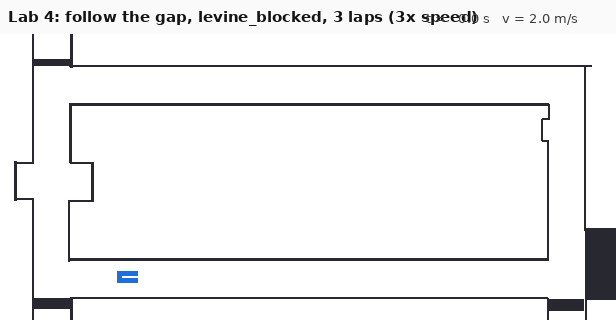
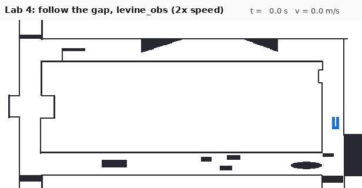

# Lab 4: Follow the Gap

[RoboRacer Lab 4](https://github.com/f1tenth/f1tenth_lab4_template): a reactive planner that drives toward free space in the LiDAR scan, on an empty track and on one full of obstacles.

## Results in the simulator

**levine_blocked**: 3 counter-clockwise laps in a row without touching a wall (31.5, 32.5 and 32.6 s, top speed 2.0 m/s).



**levine_obs**: starting on the east hallway heading north, the car clears 3 of the 4 corners (through the triangles, past the L-shaped dead-end pocket and the first box) and then clips a box in the slalom on the south hallway, where the gap between two boxes is about 0.45 m for a 0.31 m wide car. A full clean lap of this map is still to do.



*Both are replays of simulator runs, drawn from the car's recorded positions (3x and 2x speed).*

## How it works

The package is in [gap_follow/](gap_follow/). The node `reactive_node` reads `/scan` and publishes `/drive`.

1. **Preprocess**: keep the beams within ±90° of straight ahead, clip readings at 8 m, smooth with a 5-beam average. Then extend disparities: where a near obstacle edge sits next to far space, widen the obstacle by 0.25 m (half the car plus a margin), so a gap only looks open if the car fits through it.
2. **Closest point**: find the nearest reading.
3. **Bubble**: zero every beam within 0.3 m of it.
4. **Max gap**: split the free beams (further than 2.0 m) into runs and pick the run that leads furthest forward (largest `range · cos(angle)`). Walls closer than 2 m don't count as free, so a wall right beside the car at a corner can't look like the way to go.
5. **Best point**: inside that gap, take the beams within 90% of the best forward progress, and aim at the middle of the run closest to straight ahead.
6. **Drive**: steer at that point's angle, at 2.0 / 1.5 / 1.0 m/s depending on how sharp the turn is, and slow down when anything is within 1.5 m ahead.

Changes from the textbook version, each one fixing a crash or wrong turn found in testing:

| Change | Why |
|---|---|
| Score gaps and points by forward progress, not width or raw depth | At corners the hallway the car just left can look as deep as the way ahead, and the car U-turned into it. On levine_obs the wide L-shaped pocket out-voted the narrow passage that continues. |
| Ignore anything closer than 2 m as free space | Nearby walls at a corner formed a "gap" pointing into the corner. |
| Don't steer toward a side with something right beside the car (0.3 m beside the front, 0.17 m beside the rear) | The car cut the inside of corners and clipped them. |

Each map has its own launch file, with its own parameters:

| Map | Launch file | Speeds (fast / medium / slow) |
|---|---|---|
| levine_blocked | `levine_blocked_launch.py` | 2.0 / 1.5 / 1.0 m/s (defaults) |
| levine_obs | `levine_obs_launch.py` | 1.5 / 1.2 / 0.8 m/s |

## Run it

In VS Code (connected to WSL), **Terminal → Run Task…** and pick a Lab 4 task, or:

```bash
ros2 launch gap_follow levine_blocked_launch.py            # simulator + RViz + the node
ros2 launch gap_follow levine_obs_launch.py
ros2 launch gap_follow levine_obs_launch.py sim:=false     # just the node, e.g. on the car
```

Written with AI assistance (Claude Code) and tested in the RoboRacer simulator.
