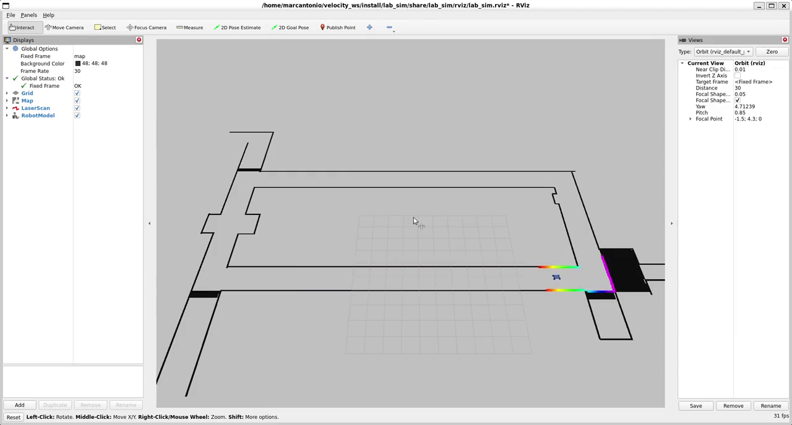
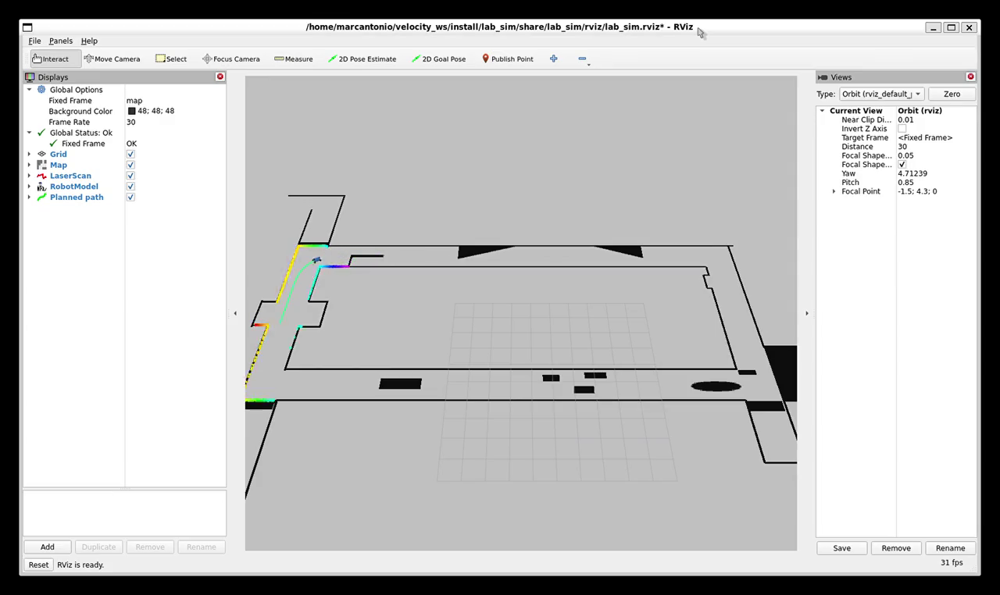

# Lab 4: Follow the Gap

[RoboRacer Lab 4](https://github.com/f1tenth/f1tenth_lab4_template): drive laps of a track by steering toward free space in the LiDAR scan, first on an empty track (`levine_blocked`) and then on one full of obstacles (`levine_obs`).

## Results in the simulator

| levine_blocked, normal speed (2 m/s) | levine_blocked, fast (`max_speed` 10) | levine_obs, 13 obstacles |
|---|---|---|
| [](media/lab4_follow_the_gap_normal.mp4) | [](media/lab4_follow_the_gap_fast.mp4) | [](media/lab4_obstacle_avoidance.mp4) |
| 3 laps in a row, about 32 s a lap | 3 laps in a row, about 15 s a lap | Clean laps, about 35 s a lap |

*Click a picture to play its video: screen recordings of RViz while the car drives counter-clockwise laps in the RoboRacer simulator.*

Each map runs its own node:

| Map | Node | Launch file | `max_speed` |
|---|---|---|---|
| levine_blocked | `reactive_node` (follow the gap) | `levine_blocked_launch.py` | 2.0 m/s |
| levine_obs | `obstacle_avoidance` | `levine_obs_launch.py` | 8.0 m/s |

## levine_blocked: follow the gap

The node `reactive_node` reads `/scan` and publishes `/drive`.

1. **Preprocess**: keep the beams within ±90° of straight ahead, clip readings at 8 m, smooth with a 5-beam average. Then extend disparities: where a near obstacle edge sits next to far space, widen the obstacle by 0.25 m (half the car plus a margin), so a gap only looks open if the car fits through it.
2. **Closest point**: find the nearest reading.
3. **Bubble**: zero every beam within 0.3 m of it.
4. **Max gap**: split the free beams (further than 2.0 m) into runs and pick the run that leads furthest forward (largest `range · cos(angle)`). Walls closer than 2 m don't count as free, so a wall right beside the car at a corner can't look like the way to go.
5. **Best point**: inside that gap, take the beams within 90% of the best forward progress, and aim at the middle of the run closest to straight ahead.
6. **Drive**: steer at that point's angle, at full / 75% / 50% of `max_speed` depending on how sharp the turn is, and slow down when anything is within 1.5 m ahead.

Changes from the textbook version, each one fixing a crash or wrong turn found in testing:

| Change | Why |
|---|---|
| Score gaps and points by forward progress, not width or raw depth | At corners the hallway the car just left can look as deep as the way ahead, and the car U-turned into it. |
| Ignore anything closer than 2 m as free space | Nearby walls at a corner formed a "gap" pointing into the corner. |
| Don't steer toward a side with something right beside the car (0.3 m beside the front, 0.17 m beside the rear) | The car cut the inside of corners and clipped them. |

On top of the speed steps, the node limits speed in a turn to what the tyres can hold, brakes for anything ahead early enough to be down to 2 m/s 1 m before it, and above 2.5 m/s smooths the steering and keeps a wider margin from obstacle edges and walls beside it. Tested three laps each without touching a wall at `max_speed` 2 (≈32 s laps), 3 (≈22 s), 5 (≈15 s) and 10 (≈15 s).

## levine_obs: obstacle avoidance

Follow the gap alone can't get round levine_obs: the gaps between obstacles are as tight as 0.44 m for a 0.31 m wide car, and it clipped a box in the south hallway slalom. The node `obstacle_avoidance` mixes how the ForzaETH and UNICORN racing stacks drive:

- **Racing line planned offline** from the map (`ros2 run gap_follow make_racing_line levine_obs`, saved as [config/levine_obs_line.csv](gap_follow/config/levine_obs_line.csv)). It searches every line through the whole lap for the one that keeps the car's real footprint (the simulator's 0.33 × 0.31 m box) at least 5 cm clear, never turns tighter than 1/m, and has the most room.
- **Follow the line directly** while the LiDAR shows it clear, steering back onto it when the car drifts. A route replanned from wherever the car is would keep accepting each small drift, and in the tight south-east corner a few cm too wide leaves no way round.
- **Route round anything not on the map** with a local planner, then rejoin the line.
- **Steering that accounts for lag**: it reads the line's bend where the car will be once the command takes effect (the node measures its own lag), and compares the line's direction with the way the LiDAR point is actually moving.
- **Speed profile** in the style of ForzaETH's MAP controller: slow where there is little room or a sharp bend, fast in open hallway. Every command is checked by simulating the car before it is sent.

Tested over 2 laps from the official start at `max_speed` 2, 3, 5 and 8, with up to 30 ms of extra command lag, and through the launch file in the ROS simulator (35.0 s and 34.6 s laps). Past about 5 m/s the obstacles and corners set the pace.

## Run it

In VS Code (connected to WSL), **Terminal → Run Task…** and pick a Lab 4 task, or:

```bash
ros2 launch gap_follow levine_blocked_launch.py sim:=true                  # simulator + RViz + follow the gap
ros2 launch gap_follow levine_blocked_launch.py sim:=true max_speed:=10.0  # the same, fast
ros2 launch gap_follow levine_obs_launch.py sim:=true                      # simulator + RViz + obstacle avoidance
ros2 launch gap_follow levine_obs_launch.py                                # just the node, as the lab's grader runs it
```

Without `sim:=true` the launch files start only the node with that map's parameters, which is what the lab's grader expects (it runs its own simulator). When a node is stopped it sends a stop command, so the car doesn't keep driving on its last command.

The tests in [gap_follow/test/](gap_follow/test/) check both nodes on synthetic scans:

- **Follow the gap**, like the grader does, each case also mirrored: a pillar ahead (steer toward the wider side), a corridor with the car near one wall (steer toward the open side) and a dead end with the exit to one side (aim into the exit).
- **Obstacle avoidance**: plans round a box ahead, never turns tighter than the car can, follows the racing line when it's clear and leaves it to go round something that isn't on the map.

Run them with `python3 -m pytest lab4/gap_follow/test`, or from VS Code's Testing panel.

Written with AI assistance (Claude Code) and tested in the RoboRacer simulator.
